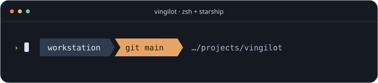

# Vingilot

A compact **zsh prompt with Starship context**. Native zsh handles the layout and working-directory tail; Starship supplies Git, development environments, command status and duration.



The preview illustrates the layout. For the original glyphs, select a [Nerd Font](https://www.nerdfonts.com/) in your terminal. Prompt startup performs no installation or update check.

## Install

You need zsh and Starship. Download `vingilot-<version>.tar.gz` and `SHA256SUMS` from the same [GitHub release](https://github.com/donorconohue/vingilot/releases). Verify the archive with `sha256sum -c SHA256SUMS` on Linux or `shasum -a 256 -c SHA256SUMS` on macOS. GitHub CLI can also verify the release asset with `gh release verify-asset <tag> <archive> -R donorconohue/vingilot`.

Extract the verified archive and run `./install.zsh --user` from its directory. This copies two files into `${XDG_DATA_HOME:-$HOME/.local/share}` and prints activation instructions. It does not edit your shell startup files or install dependencies.

Add to your interactive zsh configuration:

```zsh
fpath=("${XDG_DATA_HOME:-$HOME/.local/share}/zsh/site-functions" $fpath)
autoload -Uz promptinit
promptinit
prompt vingilot
```

Use `setopt TRANSIENT_RPROMPT` if you want zsh to clear the previous right prompt after a command. For shared installations, `./install.zsh --system` installs the same two files under `/usr/local` with appropriate privileges. Ensure its zsh site-functions directory is in `fpath`.

To remove Vingilot, remove the activation lines and the installed `zsh/site-functions/prompt_vingilot_setup` and `vingilot/starship.toml` files from the selected installation prefix.

## Make it yours

Set overrides before `prompt vingilot`. Use `prompt -h vingilot` for the full list.

| Setting | Default / behavior |
| --- | --- |
| `VINGILOT_CWD_MAX` | 20 characters of directory tail |
| `VINGILOT_CWD_COLOR` | `#707784` |
| `VINGILOT_RPROMPT_GAP` | 1 column |
| `VINGILOT_SYMBOL`, `VINGILOT_ROOT_SYMBOL` | User and root command markers; ASCII overrides are supported |
| `VINGILOT_STARSHIP` | Starship on `PATH`, or `/usr/local/bin/starship`; set a shell-safe absolute executable path to override |

Starship's zsh initialization needs an executable path without spaces or shell metacharacters.

An existing `STARSHIP_CONFIG` takes precedence. Vingilot otherwise checks your per-user Vingilot configuration, `VINGILOT_STARSHIP_CONFIG`, then user and system installation paths. Edit your own copy if you want a different Starship configuration.

## Build and test

End users do not need Python or uv. For development, use the pinned Python/uv project, `uv sync --locked`, then `uv run --locked python tools/prepare-starship` to retrieve the checksum-pinned test binary into `.toolchain/`. Run `make check` with zsh available. `make build` regenerates the committed TOML, and `make release` checks and packages the exact installation inputs.

The ASCII template at `starship/vingilot.toml.in` is the editing authority for `starship/generated/vingilot.toml`. Generation is offline from the checked-in Starship Nerd Font preset. The test suite compares the preset with the pinned Starship binary and rejects generated-file drift, unexpected Unicode and unsafe prompt interpolation. See [CONTRIBUTING](CONTRIBUTING.md) for updates and releases.

Vingilot is [MIT licensed](LICENSE). The upstream Starship preset and generated symbol mappings carry the [Starship ISC notice](licenses/Starship-ISC.txt). No font files are bundled.
